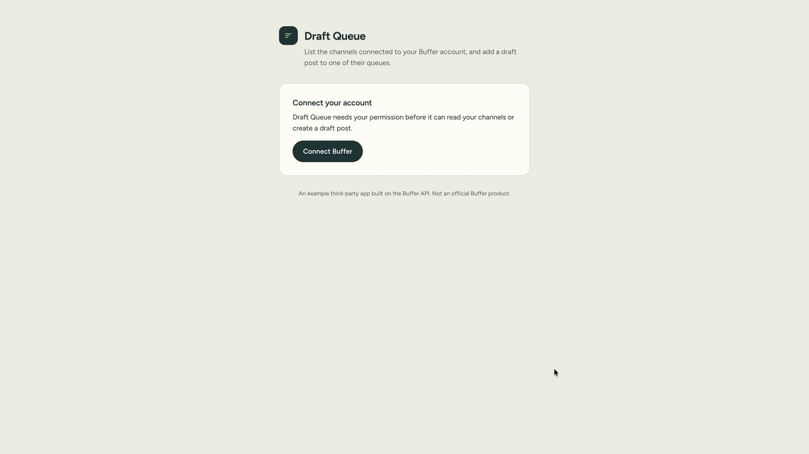

# Draft Queue: a Buffer app client example

A small, runnable example of a third-party app built on the [Buffer API](https://developers.buffer.com).

## What it does

It's a small starter app called Draft Queue which covers key components of an app client:

1. A user connects their own Buffer account over OAuth 2.0 (Authorization Code + PKCE).
2. The app lists the channels in their Buffer organization.
3. The user picks a channel, and the app creates a **draft** post in that channel's queue.

   

Use it as a starting point for your own integration. Clone it, configure it with your own app client, build new features on top, or share it with your AI coding agent as a reference.

## Prerequisites

- Node.js 22
- A [Buffer](https://buffer.com) account
- A Buffer app client (client ID and secret). See the [authentication guide](https://developers.buffer.com/guides/authentication.html) for how to register one.
- (Optional) Vercel or another hosting provider, if you want to deploy the app

## Setup

1. From the root of the repository, move into this sample:

   ```bash
   cd samples/app-client-starter-app
   ```

2. Install dependencies:

   ```bash
   npm install
   ```

3. Create your environment file:

   ```bash
   cp .env.example .env
   ```

   Then fill in the values:

   | Variable | Purpose |
   | --- | --- |
   | `BUFFER_CLIENT_ID` | Your app client ID from Buffer. |
   | `BUFFER_CLIENT_SECRET` | Required for a confidential client. Never expose it to the browser or commit it. |
   | `SESSION_SECRET` | At least 32 characters. Generate one with `openssl rand -hex 32`. Optional locally, required in production. |
   | `REDIRECT_URI` | It must exactly match the redirect URI registered for your app client. |
   | `PORT` | Port your app is running on locally. Should match the port specified in the `REDIRECT_URI`.

5. Generate a self-signed certificate for local HTTPS:

   ```bash
   npm run certs
   ```

   Buffer doesn't accept `http://localhost` redirect URIs, so the dev server runs over HTTPS. If you skip this step, `npm start` generates the certificate on first run.

6. Run the app locally:

   ```bash
   npm start
   ```

   Open `https://localhost:3000` and accept the self-signed development certificate in your browser.

## Project structure

| Path | What it holds |
| --- | --- |
| `lib/` | The app itself: OAuth and GraphQL (`buffer.js`), the session cookie (`session.js`), Express routes (`app.js`), and configuration (`config.js`). |
| `public/` | The single-page UI. |
| `server.js` | Local HTTPS dev server. |
| `api/index.js`, `vercel.json` | Serverless entry point and routing, using Vercel as an example host. |
| `test/` | Regression tests for the protocol and security-critical helpers. |
| `docs/` | The demo GIF used in this README. |
| `scripts/` | Generates the self-signed certificate for local HTTPS. |

## What this example covers

- **OAuth 2.0 with PKCE:** the full Authorization Code flow with PKCE. It sends the user to Buffer to authorize the app, handles the redirect back, and exchanges the authorization code for tokens. See `lib/buffer.js`.
- **GraphQL requests:** authenticated calls to the Buffer GraphQL API. The app reads the user's organization and channels, then runs a mutation that creates a draft post in a channel's queue.
- **Refresh tokens:** the app requests the `offline_access` scope, so Buffer returns a refresh token alongside the access token. When the access token expires, the app renews it without asking the user to sign in again. Both tokens are sealed inside an HttpOnly cookie, so browser JavaScript can never read them.
- **Handling rate limits:** rate limits apply per app client, so every user of the app shares one quota. When Buffer responds with HTTP 429, the app reads the `Retry-After` header. If the wait is 5 seconds or less, it waits and retries the request once. Otherwise it returns the error to the user with the wait time. See `graphql()` in `lib/buffer.js`.
- **Deployment:** a working setup for Vercel (`api/index.js` and `vercel.json`) shows how to run the same app as a serverless deployment. If you deploy from this repository, set the project's root directory to `samples/app-client-starter-app`. You can adapt it to any Node.js host.

## Support and contributing

This sample is provided as-is for educational purposes and isn't covered by Buffer's product support or service-level agreements. If you find a bug or something out of date, please [open an issue](../../../../issues). See [CONTRIBUTING.md](../../CONTRIBUTING.md) for how we handle contributions.

## License

This sample is licensed under the MIT License. See the [LICENSE](../../LICENSE) file at the root of the repository.
